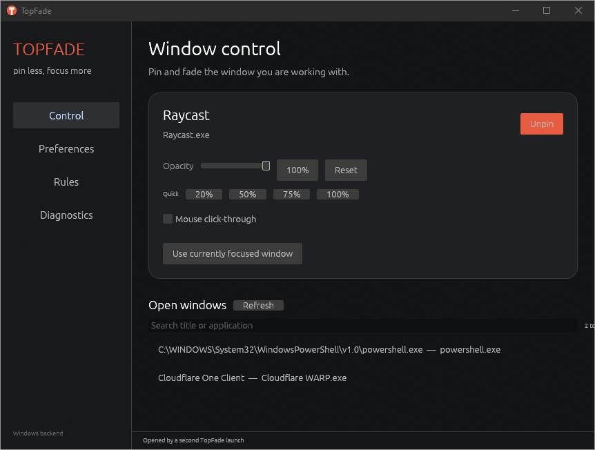
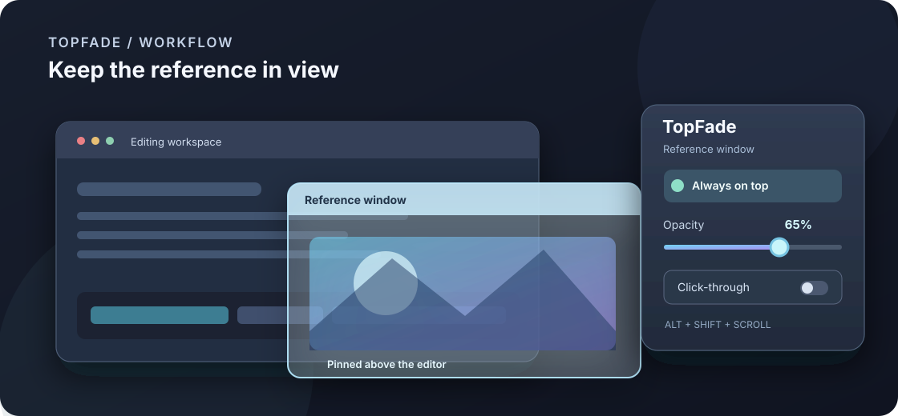
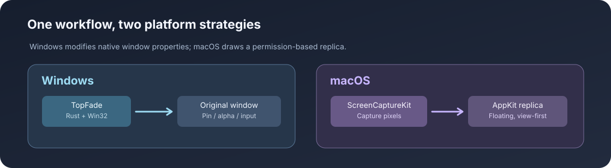

<div align="center">


# TopFade

**Pin a window. Fade it. Keep working.**

A small, event-driven window utility for Windows, with an experimental native macOS companion.

[](https://github.com/sp1ffyparsley/TopFade/actions/workflows/ci.yml)


[](LICENSE)

</div>



<sub>Real screenshot of the installed Windows version, showing its window control, opacity presets, and an active pinned window. No AI rendering or mockup.</sub>

<details>
<summary>See the concept illustration of pinning and fading</summary>



*Illustration only. The screenshot above shows the real application.*

</details>

## Why TopFade?

Keep references, video previews, notes, or any normal desktop window above other windows. Adjust opacity directly with the mouse wheel without launching a separate automation engine.

| Pin | Fade | Remember |
| :--- | :--- | :--- |
| Toggle always-on-top with one shortcut. | Hold **Alt+Shift** and scroll over a window. | Restore your saved settings when a matching window reopens. |

TopFade uses native Windows APIs, a bounded event queue, and no continuous hotkey polling. It doesn't modify WindowTop or require AutoHotkey.

> [!NOTE]
> **Windows is the tested primary platform.** macOS uses a floating screen-capture replica rather than modifying the original app window. In-place transparency is **not** equivalent on macOS; see [Mac limitations](docs/MACOS_SUPPORT.md). The Mac build has not passed a physical-device runtime gate.

## Quick start

For a local Windows source build, install [Rust](https://rustup.rs/) and the MSVC C++ build tools, then run:

```powershell
cargo build --release --locked
.\scripts\Install-Windows.ps1 -SkipBuild -Launch
```

To remove TopFade without deleting your saved preferences:

```powershell
.\scripts\Install-Windows.ps1 -Uninstall
```

There is **no published signed installer or production macOS release** yet. GitHub Actions builds source artifacts for review, not a claim of end-user release qualification.

## Status

| Platform | Implementation | Release state |
| --- | --- | --- |
| Windows 10/11 x64 | Direct Win32 topmost, opacity, click-through, global input, tray, rules, and remembered windows | Source and real-window integration testing performed; build from source |
| macOS 13+ | Native AppKit menu app with ScreenCaptureKit floating replicas, Carbon hotkey, modified-scroll input, persistence, and diagnostics | Experimental source; native build, permissions, and physical runtime validation required |



Windows can modify another application's native window directly. Public macOS APIs do not expose an equivalent operation, so the Mac build creates a live, movable always-on-top replica of the selected source window. It does not disable System Integrity Protection or use private WindowServer APIs. **Mac opacity currently adjusts the replica panel, not the original application window.** When the replica is directly over its unchanged opaque source window, reducing the panel's alpha may reveal that same source content rather than the desktop behind it. True in-place see-through behavior is not yet established on Mac and would need a separately qualified capture/compositing approach; do not treat the Mac mode as full feature parity with Windows.

## Core Controls

| Action | Windows | macOS |
| --- | --- | --- |
| Toggle the focused window | `Ctrl+Win+T` | `Control+Command+T` |
| Adjust opacity | Hold `Alt+Shift` and scroll | Hold `Option+Shift` and scroll over a replica |
| Open preferences | `Ctrl+Alt+,` | Menu bar item |

`Ctrl+Win+T` is registered as that exact native Windows shortcut. There is no hidden `Alt+Z` binding and no process translating one key combination into another.

## Features

- Native always-on-top control on Windows through `SetWindowPos`.
- Native Windows opacity and click-through through layered window styles.
- Visible opacity fader next to the pointer.
- Searchable open-window picker with application/state labels and one-click opacity presets.
- Remembered pin and opacity state, restored when matching applications reopen.
- Diagnostics controls to inspect, forget, or clear remembered application state without editing JSON.
- Include, exclude, auto-pin, and default-opacity rules on Windows.
- Event-driven input and window restoration. There is no timer script or continuous key polling.
- Separate bounded priority and window-notification queues keep hotkeys and opacity input responsive during event bursts.
- Tray actions are also bounded, and TopFade never hides itself at startup or close when the tray owner failed to initialize.
- Foreground history from native WinEvents keeps the hotkey on the last real application when a Windows notification surface temporarily owns focus.
- Preferences for hotkeys, opacity, fader appearance, bounded diagnostics, click-through confirmation, launch at login, and startup behavior.
- System tray/menu bar controls and single-instance protection.
- A second Windows launch opens the existing instance through a dedicated event channel, and quitting prompts before staged preference or rule changes are discarded.
- Atomic settings/state writes with backups and invalid-file recovery on Windows.
- Coalesced opacity/state persistence avoids a disk flush for every wheel, slider, move, or resize event.
- Closed-window cache entries are pruned during refresh/restoration scans, and rule patterns ignore accidental surrounding whitespace.
- Existing Windows layered alpha/color-key state is restored exactly; unsupported per-pixel layered windows are left unchanged instead of being overwritten.
- macOS capture delivers only the newest pending frame to AppKit, preventing a main-thread frame backlog while the UI is busy.
- macOS capture startup/stop races are generation-checked and explicitly stop stale streams before they can become orphaned.
- macOS modified scroll follows the actual front-to-back replica order and passes through unchanged when the pointer is outside every replica.
- macOS restoration coalesces overlapping scans, rechecks current remembered state before applying results, and ignores unrelated application activations.
- Rotating size-bounded logs, fatal/panic reports, and user-exportable diagnostic reports.
- Safe transactional install scripts that verify hashes, preserve the previous TopFade binary/app, and never touch WindowTop.

Windows launch at login and hidden tray startup are enabled by default so TopFade's global controls stay available. The resident process waits for native OS events while idle; it does not poll continuously. Both startup preferences remain visible in Preferences.

## Windows

### Requirements

- Windows 10 or 11, x64
- Rust 1.85 or newer to build from source
- Visual Studio C++ build tools required by the Rust MSVC target

### Build And Verify

```powershell
cargo fmt --all -- --check
cargo test --locked
cargo clippy --locked --all-targets -- -D warnings
cargo build --release --locked
.\scripts\Test-WindowsIntegration.ps1 -Executable .\target\release\topfade.exe
```

The integration verifier uses a real local text-editor window and a disposable non-activating topmost decoy. It tests nonzero fatal exit codes, a built-in self-test that exits after native hook teardown, exact `Ctrl+Win+T` input, foreground-versus-cursor targeting, topmost on/off, remembered restoration after close/reopen, repeated `Alt+Shift+wheel` opacity while the fader is visible, forced-exit recovery metadata, duplicate-launch activation, hidden idle CPU, and new error logs. The self-test also presets native layered alpha plus color-key attributes, fades the fixture, and verifies their exact restoration. Every test window is restored and every disposable fixture is removed before exit.

### Install

```powershell
.\scripts\Install-Windows.ps1 -Launch
```

This installs per-user to `%LOCALAPPDATA%\Programs\TopFade`, creates missing Start Menu directories and a shortcut, registers the installed executable in the current user's Run key, and preserves `%LOCALAPPDATA%\TopFade`. Source, staged, and installed hashes must match; executable, shortcut, Run value, and receipt changes roll back together on failure. It does not request administrator access or modify `C:\Program Files\WindowTop`.

To install without launch at login:

```powershell
.\scripts\Install-Windows.ps1 -SkipBuild -Launch -LaunchAtLogin:$false
```

Uninstall while keeping settings and remembered windows:

```powershell
.\scripts\Install-Windows.ps1 -Uninstall
```

Add `-RemoveData` only when TopFade's own settings and logs should also be deleted.

## macOS

### Requirements

- macOS 13 or newer
- Xcode Command Line Tools with Swift 5.9 or newer
- Screen Recording permission for live replicas
- Accessibility permission when modified scroll should suppress the original scroll event; Input Monitoring is a lower-privilege listen-only alternative

### Build And Verify

```bash
bash scripts/Build-Mac.sh
bash scripts/Test-MacIntegration.sh
bash scripts/Test-MacInstallerTransaction.sh
```

The integration verifier refuses to touch an existing TopFade or TextEdit session. It launches a disposable real document, posts the exact native `Control+Command+T` chord through the production Carbon handler, and posts `Option+Shift+scroll` through the production event tap. It verifies that scrolling outside every replica passes through untouched, then verifies opacity down/up and the event-driven fader over the replica. It closes and reopens TextEdit, checks remembered restoration, posts the hotkey again to unpin/forget, waits for its owned TextEdit process to terminate, and removes the disposable fixture. Preferences, logs, reports, and the receipt live under `dist/macos/integration-profile`; the gate also proves the production preferences domain was unchanged, the temporary preferences suite was removed, legacy remembered records migrate safely, same-title records stay distinct, and installer interruption checkpoints roll back exactly.

### Install

```bash
bash scripts/Install-Mac.sh --launch
```

The default destination is `~/Applications/TopFade.app`. Source, staged, and installed executable hashes must match. A previous app is retained as `~/Applications/TopFade.previous.app`; an older rollback slot is preserved until promotion succeeds, and app plus receipt are restored together if verification fails or the installer is interrupted. `scripts/Test-MacInstallerTransaction.sh` fault-injects each promotion checkpoint inside an isolated temporary home. Local builds are ad-hoc signed. A Developer ID supplied through `CODESIGN_IDENTITY` is a prerequisite for distribution, but notarization is a separate release step and is not performed by this script.

Uninstall preserves preferences and remembered replicas by default and unregisters TopFade's own login item before removing the app:

```bash
bash scripts/Install-Mac.sh --uninstall
```

Add `--remove-data` only to remove TopFade's exact preferences, logs, reports, and saved-state paths.

## Data And Diagnostics

| Platform | Settings/state | Logs | Reports |
| --- | --- | --- | --- |
| Windows | `%LOCALAPPDATA%\TopFade` (the only active settings owner) | `%LOCALAPPDATA%\TopFade\logs` | `%LOCALAPPDATA%\TopFade\reports` |
| macOS | `~/Library/Preferences/com.tavito.topfade.plist` | `~/Library/Logs/TopFade` | `~/Library/Application Support/TopFade/Reports` |

Windows command-line diagnostics:

```powershell
topfade.exe --self-test
topfade.exe --diagnostic-report
```

On either platform, use the Diagnostics or menu-bar export action for a report suitable for crash investigation. Reports contain window titles and executable/application identifiers, so inspect them before sharing publicly.

## Documentation

- [Architecture](docs/ARCHITECTURE.md)
- [Research decisions](docs/RESEARCH.md)
- [Troubleshooting](docs/TROUBLESHOOTING.md)
- [Validation record](docs/VALIDATION.md)
- [macOS support and limitations](docs/MACOS_SUPPORT.md)
- [Contributing](CONTRIBUTING.md)
- [Security](SECURITY.md)
- [Changelog](CHANGELOG.md)

## License

TopFade source is licensed under the [MIT License](LICENSE). External projects influenced design decisions only as recorded in [docs/RESEARCH.md](docs/RESEARCH.md); no AGPL, GPL, MS-RL, proprietary WindowTop, or private macOS implementation was copied into this repository.
